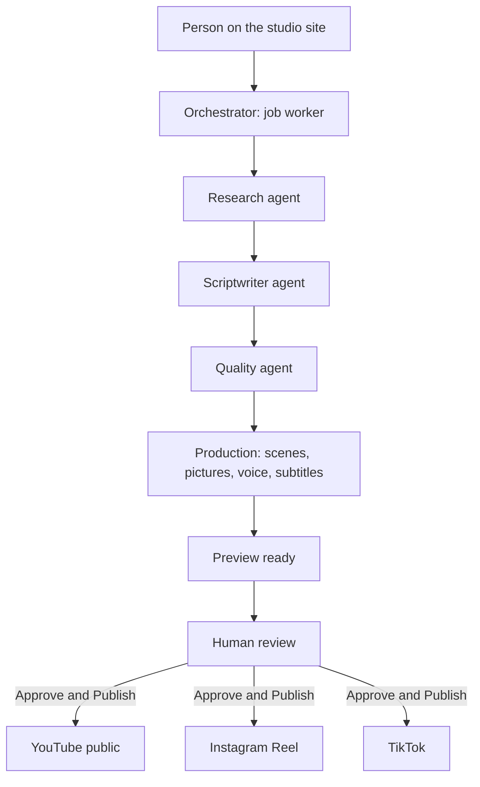
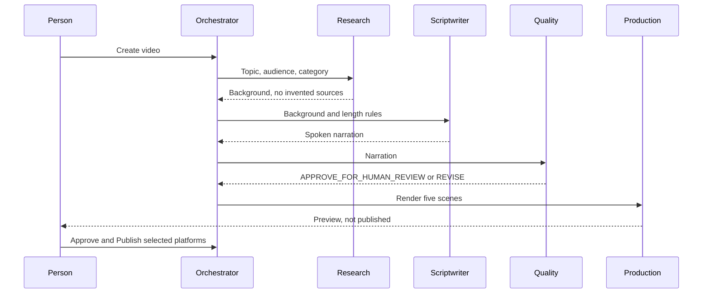

# J3G YouTube AI — multi-agent content system

Repository: https://github.com/thefreemannet/youtube-ai

This document is the Level 1 design and the map of the Level 2 implementation in that repository. The running studio is https://youtube-ai.lab.j3gdigital.com. Credentials, tokens, and rendered videos are not in the repository.

The implementation branch is `categories`. The GitHub default branch is still `main`. After the repository is public, reviewers should open `categories`, or the default branch should be changed to `categories`, so this document and the current application are the ones on the front page.

## Narrative

A person signs in and asks for one educational video. They choose a topic, an optional script, an optional picture, a category, and English, Spanish, or both. The studio does not start a video until that request arrives.

An orchestrator then runs a fixed sequence of specialist agents. The research agent prepares the background and is not allowed to invent sources. The scriptwriter writes 160 to 190 words of original narration, long enough to last at least a minute. The quality agent reads that narration and must answer with one recommendation: approve it for a human, or revise it. It cannot claim it checked the outside world.

If a usable narration exists, the production step plans five vertical scenes, draws one cartoon still for each scene, speaks the narration with one consistent voice, and burns the real words in as subtitles. The preview is 720 by 1280, H.264 and AAC. Nothing is uploaded at this point.

A person watches the preview. Publishing happens only when that person presses Approve & Publish and checks a platform. YouTube is posted public. Instagram is posted as a Reel and then confirmed. TikTok is posted with the category hashtags. A TikTok post is public only after TikTok has approved the production app. Until then TikTok allows only a private post, and the studio follows that limit.

The same voice is used for English and Spanish. Spanish is a language flag on that voice, not a second speaker. HVAC videos use the technician character. Every other category uses the presenter. The Family category explains why family matters. Daily automatic batches are off, so a video exists only because someone asked for it on the site.

## Diagrams





## Agent specifications

Every model agent returns JSON with `agent`, `status`, `result`, and `warnings`. The name in the JSON must match the agent that was called. A failed agent stops the job. Agents do not invent uploads, view counts, or sources.

| Agent | Responsibility | Does not do | Where it runs |
| --- | --- | --- | --- |
| Orchestrator | Accepts one web request, runs the agents in order, keeps the job state, and starts the matching Spanish video only when the person asked for both languages. | Does not publish. Does not create a daily batch of videos. | `app/job_worker.py`, `app/workflow_dashboard.py` |
| Research | Writes the background for the topic and the category audience. Separates what is known from what is assumed. | No live web search. No invented citations. Does not turn a non-HVAC topic into an HVAC lesson. | `run_agent("research")` in `app/agents.py` |
| Scriptwriter | Writes original spoken narration with a hook, body, and close. Target length is 160 to 190 words. A short script supplied by the person is expanded without changing the idea. | No headings, stage directions, or citations in the spoken text. | `run_agent("scriptwriter")` |
| Quality | Checks clarity, unsupported claims, and originality. Returns exactly one of `APPROVE_FOR_HUMAN_REVIEW` or `REVISE`. | Does not claim an outside fact-check. A revise warning does not block the person from reviewing a finished preview. | `run_agent("quality")` |
| Production | Splits the narration into five scenes, draws one 9:16 cartoon per scene, speaks the narration, writes subtitles, and encodes the preview. | Does not publish. Does not overwrite a finished preview. | `app/production_engine_v2.py`, `app/cartoon_scenes.py` |
| Publishing | Builds the title, description, caption, and category hashtags, then queues only the platforms the person checked. | Never says an upload happened until the platform record exists. Does not retry a post that already has a platform id. | `app/approve_and_publish.py` and the YouTube, Instagram, and TikTok workers |
| Analytics | May discuss only numbers that were supplied to it. | Never invents views, subscribers, or watch time. | Role defined in `app/agents.py` |
| Revenue | May discuss expenses and revenue only when the figures are labeled as supplied or estimated. | Never presents a guess as money already earned. | Role defined in `app/agents.py` |

The picture step asks OpenRouter for one Gemini still per scene, in the character for that category, with no words inside the drawing. The spoken words stay in the subtitle track. The voice is a local XTTS voice. Spanish uses that same speaker with the language set to Spanish.

## Privacy, security, and publishing rules

- Sign-in is required. A new account stays pending until the administrator approves it. One administrator manages accounts and the TikTok connection.
- Publishing is a separate human action. The preview step cannot upload.
- Platform tokens stay on the server, outside this repository, and are not written into logs.
- The research and quality agents are instructed to refuse invented sources and invented verification.
- TikTok posts are marked as generated content. A public TikTok post is sent only when TikTok offers a public privacy level. Until the production app is approved, TikTok offers only a private post.
- Category rules keep security lessons defensive. They do not describe attacks.

## Level 2 implementation

The program in https://github.com/thefreemannet/youtube-ai is the implementation. The path a visitor can clone after the repository is public:

```
git clone https://github.com/thefreemannet/youtube-ai.git
```

Open `docs/SYSTEM_DESIGN.md` on the `categories` branch for this design. The agent contracts live in `app/agents.py`. The web request enters through `app/main.py` and is carried out by `app/job_worker.py`.

This repository does not call swarms.ai or withprune.com. The orchestrator is the job worker, and each specialist is a separate call with its own role and a checked JSON result. That is the multi-agent system submitted here.
